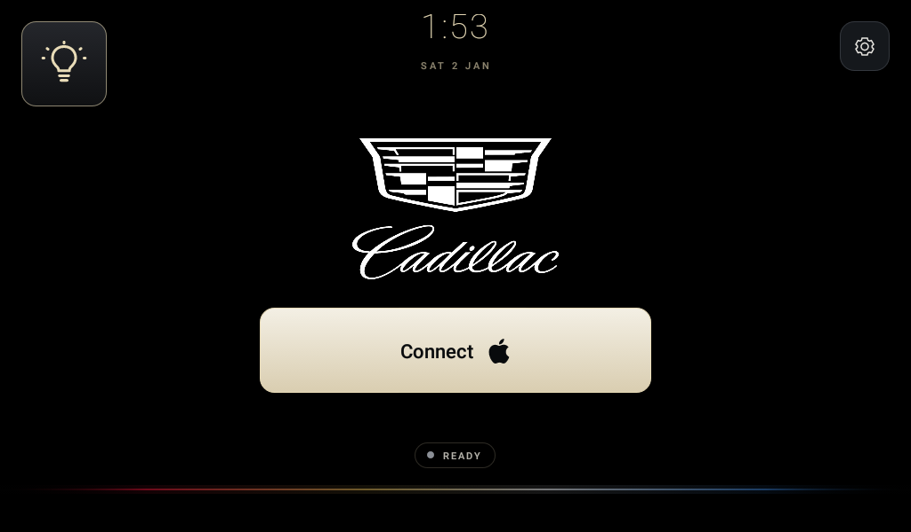
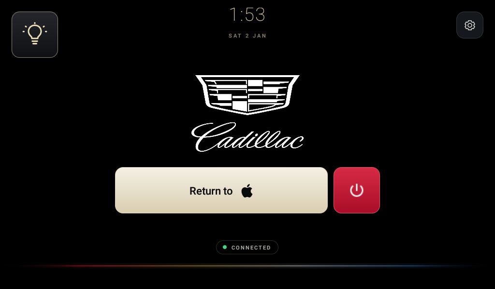
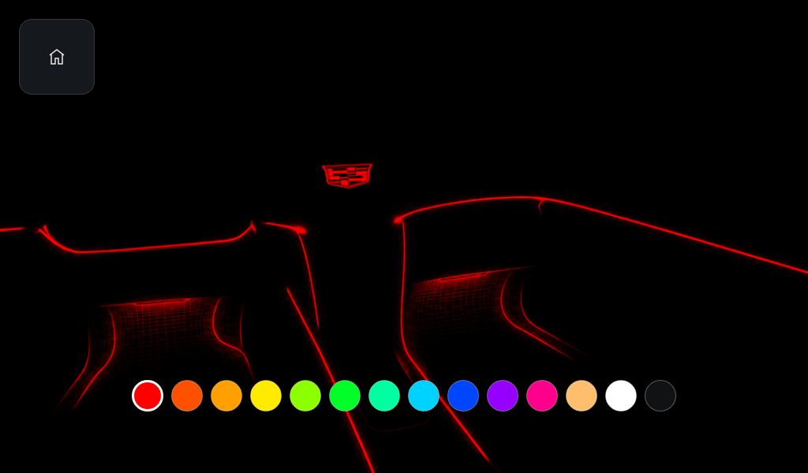
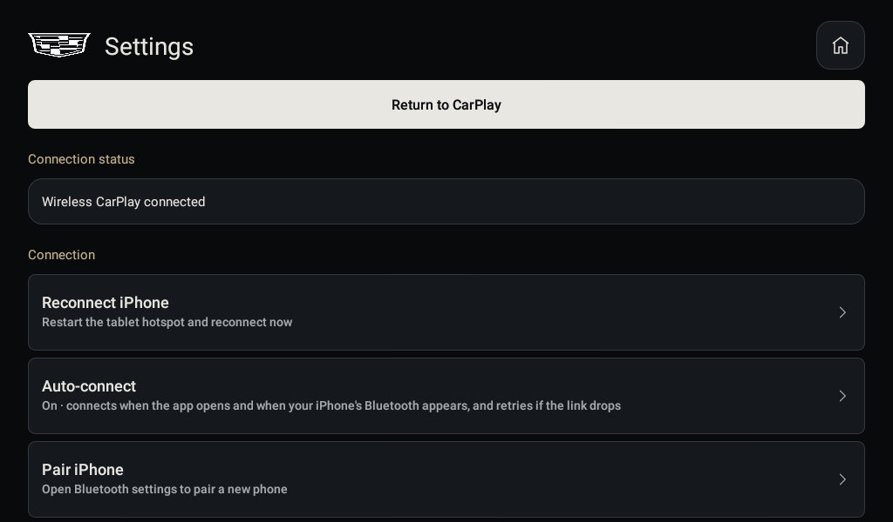
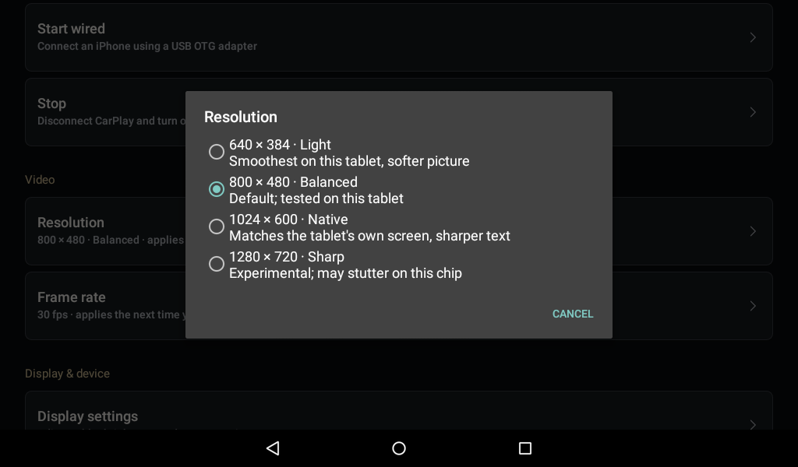

# Cadillac CTS Dashboard

**Wireless Apple CarPlay for an old Android 5.1 tablet, with a Cadillac-themed one-tap dashboard.**

This project runs CarPlay on a cheap 32-bit Android 5.1 tablet (tested on a Snook C70R, MediaTek MT6572,
1 GB RAM) mounted as a car display. One tap on **Connect** starts the tablet's own Wi-Fi hotspot, pairs
over Bluetooth and brings up CarPlay, with no router, SIM or iPhone Personal Hotspot needed.

It is a fork of [DiPlay](https://github.com/shihabal3amri/DiPlay) (which is based on
[xcertplay](https://github.com/shilapi/xcertplay)). The CarPlay engine is theirs; this fork adds an
Android 5.1 host in `legacy/` and the tablet appliance setup in `tablet-setup/`. The upstream README is kept in
[docs/UPSTREAM_README.md](docs/UPSTREAM_README.md).

> **Not an Apple-certified product, and experimental.** It works on one tablet and one iPhone so far.
> Audio and the microphone are not verified, and the microphone is disabled. See *Status* below.

| Splash | Home | Connected |
| --- | --- | --- |
|  |  |  |

## What it does

- **Connect** with the Apple logo: restarts the tablet hotspot (`Cadillac CTS`), connects the paired iPhone over
  Bluetooth and starts CarPlay. While connecting the button shows a spinner; once connected it reads
  **Return to** and a small red power button beside it disconnects.
- **Fullscreen CarPlay:** the dashboard and Android bars hide once a session starts. Back reveals the controls.
- **Settings:** choose the iPhone, hotspot password, wired or existing-Wi-Fi modes, resolution
  (640 x 384 to 1280 x 720) and frame rate (20 to 60), diagnostics and a sound test. Resolution and frame
  rate changes offer an app restart.
- **Startup:** your own Cadillac splash animation (Full, Short or Off), pure black theme with a faint crest-colour
  line, and the app can be the tablet's Home app and open at boot.
- **Auto-connect:** connects to the saved iPhone when the app opens and whenever its Bluetooth link comes up, and
  retries (5, 10, 20, then 40 s, up to 8 tries) if a connection fails or drops. Switch it off in Settings > Connection.
  A small pill at the bottom of Home shows Ready, Connecting, Connected, Reconnecting or Not connected.
- **Clock and dim mode:** a thin clock and date sit at the top of Home. After a few seconds without a touch (10 s to
  5 min, or never; set in Settings) everything fades to just the Cadillac logo, and a touch wakes it.
- **Lighting:** the square button at the top left opens a page with car-interior line art that takes the colour you pick
  from 14 dots. The same colour is sent to a Bluetooth LE LED strip (Lotus Lantern style ELK-BLEDOM or Triones
  controllers) saved in Settings > LED strip; the scanner can be limited to nearby signals. LED control has not been
  tested on real strip hardware yet.
- **Light:** about 30 MB of RAM during a session; video runs at roughly 17 to 25 fps on this chip.

| Lighting | Settings | Resolution |
| --- | --- | --- |
|  |  |  |

## Build

Requires JDK 25 (or the version in `.github/workflows/android.yml`), the Android SDK and NDK from the upstream
build notes, and a local accessory identity (never committed). From the repository root:

```sh
gradlew.bat -PlegacyAndroid51=true :legacy:assembleDebug :legacy:testDebugUnitTest :legacy:lintDebug
```

Set `ANDROID_HOME` (or `local.properties`) and, for a standalone local build, `DIPLAY_AUTH_ASSETS_DIR` to a folder
that holds `offline-mfi/identity.pk8` and `offline-mfi/certificate.p7b`. Source builds contain no authentication
assets. The full repository check is the command in `AGENTS.md`. More detail: [legacy/README.md](legacy/README.md),
[legacy/DESIGN.md](legacy/DESIGN.md) and [HANDOFF.md](HANDOFF.md).

## Tablet setup

[tablet-setup/](tablet-setup/README.md) has scripts that hide system bars, turn off the lock screen and
notifications and hide unneeded apps (all reversible), plus a ready-made Cadillac boot animation. Installing a boot
animation needs root, which this project does not provide or document.

## Status

Verified on the Snook C70R (Android 5.1) with one iPhone: wireless CarPlay over the tablet hotspot, video, touch,
fullscreen, hotspot restart, disconnect, auto-connect on launch. **Not verified:** music and call audio, LED strip
control on real hardware, reconnect retries in the car, long sessions, other tablets or
iOS versions. A video decoder error can appear and recover when the app is sent to the background.

## Credits and licence

- CarPlay engine: [DiPlay](https://github.com/shihabal3amri/DiPlay) and [xcertplay](https://github.com/shilapi/xcertplay)
  (GPL-3.0); the home and settings UI there adapts [DiAuto](https://github.com/shihabal3amri/DiAuto) (AGPL-3.0).
  Licences are in `LICENSE` and `docs/licenses`; keep these notices when distributing modifications.
- Cadillac crest and script are bundled as native vectors; sources and conversion notes are in
  [legacy/design-assets/SOURCES.md](legacy/design-assets/SOURCES.md). The splash animation was supplied by the
  project owner. Design review used [Unslop](https://github.com/heydamir/unslop) (CC BY 4.0).
- CarPlay, Apple and the Apple logo belong to Apple Inc.; Cadillac and its crest belong to General Motors.
  No affiliation or endorsement is implied. The experimental accessory identity used by the upstream project is
  described in its notices.
